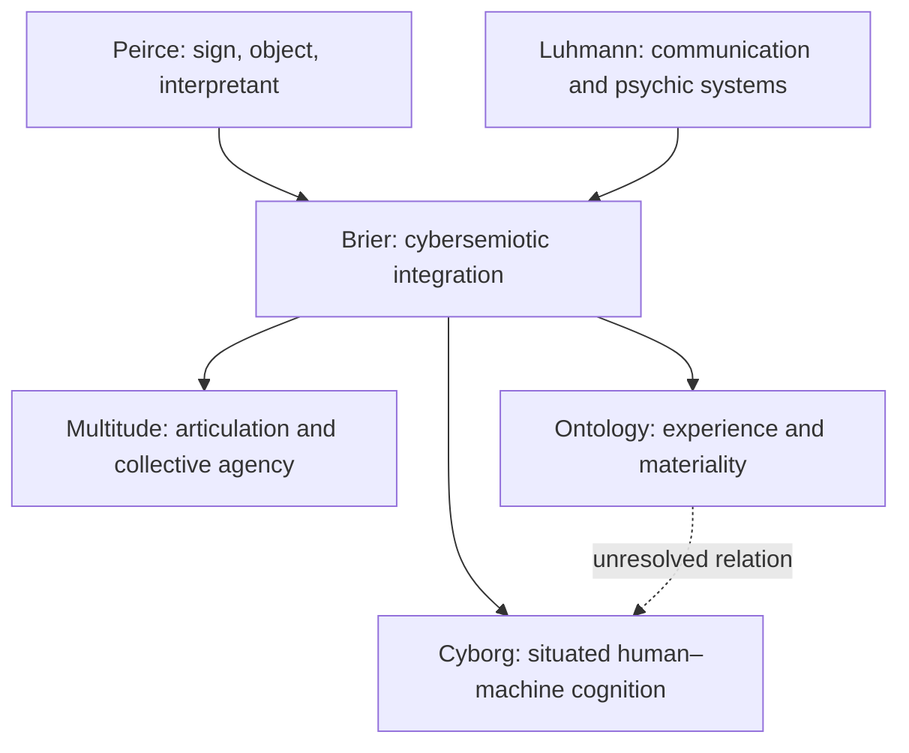

# PCM ontology: an exploratory statement

**Status: philosophical working position, not an empirical result.** Companion to the
[megatheory](MEGATHEORY.md), implementing issue #91. Labels below distinguish
**empirical** observations, **interpretive** readings, **philosophical** arguments and
**speculative** hypotheses. A proposed empirical test is not a reported result.

## One-page position

**[Philosophical]** PCM takes first-person experience seriously while keeping its ontology
open. Its Spinoza-inspired orientation is substance-monist and dual-aspect: mind and matter
may be understood as different attributes or perspectives of one reality. This is a working
analogy, not an identification of Spinoza with any contemporary theory. It does not reconcile
physicalism and idealism by definition, nor imply that Spinoza anticipated quantum mechanics.

**[Speculative]** Federico Faggin's Quantum Information Panpsychism (QIP) is the preferred
hypothesis for exploration, not an admission requirement. Bernardo Kastrup's analytic
idealism and Donald Hoffman's conscious realism remain distinct alternatives. Their
assumptions, explanatory targets and consequences must be compared rather than combined
into a single established theory. Quantum information by itself does not establish experience.

**[Philosophical]** Physicalist explanations, including neuroscientific, computational and
emergentist approaches, remain live competitors. Panpsychism must address combination;
idealism must account for apparently shared physical regularities; physicalism must address
why and how physical processes entail experience. Neutral monism and dual-aspect monism
are further options. Explanatory difficulty is not disproof, and a rival's difficulty is not
positive evidence for QIP. Compare internal coherence, explanatory reach, conceptual cost
and—where a model supplies them—distinctive empirical predictions.

**[Interpretive]** Cybersemiotics is PCM's cross-cutting hinge: Peircean sign processes and
Luhmannian communication systems make meaning, interpretation and social organization
central. They connect the political Multitude to both consciousness questions and human–machine
assemblages. This integration is PCM's proposal, not a claim that the source traditions agree.
Brier's synthesis opens consciousness questions; it does not empirically prove panpsychism.

**[Interpretive]** Wendt offers a social-science route to questioning assumptions about mind,
agency and materiality. His quantum social ontology is a substantive proposal to evaluate.
It is neither settled physics nor a premise required to analyse discourse. See the
[Wendt research note](WENDT_RESEARCH_NOTE.md).

**[Philosophical]** Intelligence, cognition, phenomenal consciousness, political subjecthood
and authorized software action are separate questions. A machine can assist reasoning without
that performance demonstrating experience. A network is not automatically a mind. Human goals,
situated judgment and accountability must remain identifiable in hybrid activity.

**[Interpretive / proposed empirical]** The cyborg formula **HUMAN + LLM + LANGUAGE + INTERNET**
is a research model of extended cognition and collective intelligence. Functional integration,
complementarity and political effects must be tested, not assumed from tool use. Neither
language nor internet access is asserted to be necessary for all cognition. See the
[operational protocol](CYBORG_RESEARCH_MODEL.md).

**[Project rule]** LaclauGPT supplies bounded empirical tools and findings within PCM. Its
locked Phase 1 theory and methodology are unchanged; speculative premises must not be silently
transferred into that programme. The software's permission model does not derive authority
from consciousness claims, introspection scores or philosophical preference.

## Peirce–Luhmann–Brier integration

**[Interpretive map]** Arrows denote conceptual dialogue, not causal mechanisms or equivalences.

| Relation [interpretive unless stated] | Possible compatibility | Unresolved tension / evaluation |
| --- | --- | --- |
| Peircean sign / object / interpretant | A campaign slogan refers to an object and produces further interpretations; interpretants need not be individual people | Do not identify the interpretant with an LLM token, a human observer or a psychic system by definition; trace actual interpretive consequences |
| Luhmann's information / utterance / understanding | Communication is a social operation whose continuation can be studied | This triad is not Peirce's triad: no one-to-one mapping; understanding is a communicative selection, not proof of shared inner experience |
| Psychic systems / social systems | Consciousness and communication can be treated as distinct, structurally coupled operations | Operational closure excludes literal transfer of thoughts between systems; a network edge does not measure subjective experience |
| Brier / Luhmann | Both make observer distinctions and meaning relevant | Brier's broader semiotic and experiential ontology does not simply follow from Luhmann's operational closure; assess whether the bridge preserves both accounts |
| Brier / Peirce | Triadic semiosis resists reduction of meaning to transmitted bits | Whether machine transformations constitute semiosis or merely support it remains an argued interpretation, not settled by fluent output |
| Cybersemiotics / Multitude | Trace how signs circulate, identities are articulated and cooperation is organized | Laclau's contingent articulation, Negri's productive immanence and Žižek's divided subject remain in tension; see the existing matrix |
| Monism / QIP [philosophical] | Both invite alternatives to a simple mind–matter split | Monism does not entail quantum consciousness; assess QIP's additional assumptions independently |
| Extended cognition / collective mind [philosophical] | A coordinated system may support cognitive tasks | Functional integration does not establish one phenomenal subject; require independent arguments for experience |

For the political and competing-ontology comparisons, retain the
[megatheory tensions matrix](MEGATHEORY_TENSIONS.md). For annotated primaries, see
[SOURCES §14](research/SOURCES.md#14-ontology-and-cyborg-primary-sources).
