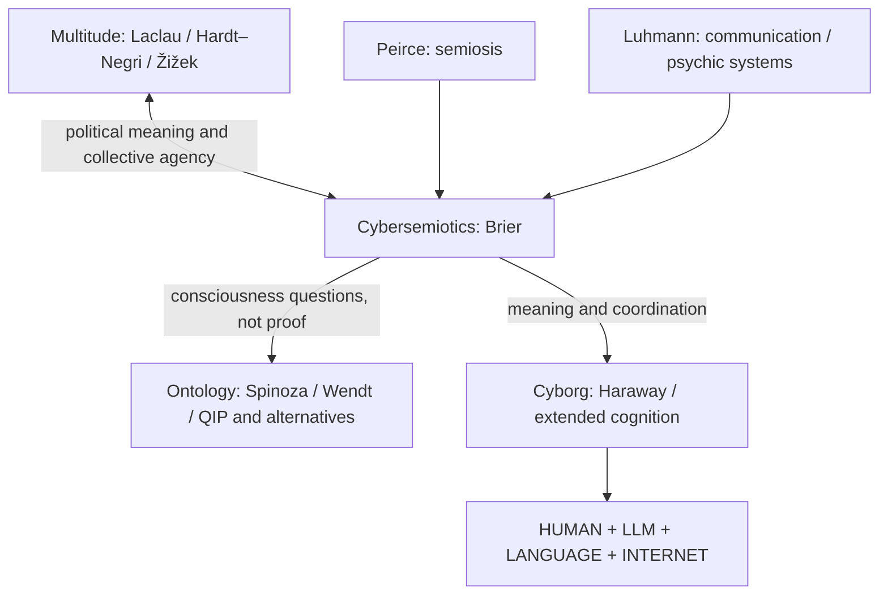

# PCM ontology, cybersemiotics and the cyborg assemblage

**Status:** interdisciplinary theory programme; linked to [megatheory](MEGATHEORY.md), [tensions](MEGATHEORY_TENSIONS.md), [reading path](MEGATHEORY_READING_PATH.md), [issue #89](https://github.com/TomiToivio/Panpsychic_Cyborg_Multitude/issues/89), and [issue #91](https://github.com/TomiToivio/Panpsychic_Cyborg_Multitude/issues/91). **No changes to LaclauGPT methodology are implied.**

## 1. Ontological commitment: comparative and open

PCM takes the hard problem of consciousness seriously without requiring panpsychism as an article of faith. **Federico Faggin's quantum information panpsychism (QIP) is a favored speculative proposal, not a proven physical model or a prerequisite for participation.** Bernardo Kastrup's analytic idealism, Donald Hoffman's conscious realism, physicalism, emergentism, neutral monism, and dual-aspect theories remain interlocutors.

A **Spinoza-inspired one-substance, many-attributes orientation** is a useful heuristic: mind and extension can be approached as different attributes of reality, not automatically identified with today's idealism and physicalism. Spinoza is not empirical confirmation of QIP. The tension between metaphysical interpretations is productive rather than something to erase.

| Position | Working question | Challenge to address | Status |
| --- | --- | --- | --- |
| Panpsychism / QIP | Is experience a fundamental dimension of reality? | Combination problem, quantum-measurement claims, lack of discriminating tests | Philosophical / speculative |
| Idealism (e.g. Kastrup) | Is experience ontologically primary? | How to account for stable public observations and causal regularities | Philosophical |
| Physicalism | Can all mental processes be explained physically? | Subjective experience and explanatory gaps | Scientific programmes + philosophical commitments |
| Dual-aspect / neutral monism | Might experience and physicality be aspects of a common underlying reality? | Defining the substrate and empirical consequences | Philosophical |

**Rule:** do not infer human, artificial or collective consciousness from system membership, linguistic fluency, integrated information or a quantum vocabulary. Preserve `is_conscious: UNKNOWN`.

## 2. Cybersemiotic bridge: Brier, Peirce and Luhmann

Søren Brier's Cybersemiotics bridges **meaning and signification** (Peirce) with **systems and communication** (Luhmann), while taking the first-person dimension seriously. It is the hinge joining political Multitude to speculative Panpsychic and operational Cyborg accounts.

| Concept | Peirce | Luhmann | Integration hypothesis / tension |
| --- | --- | --- | --- |
| Basic process | Sign–object–interpretant triad | Communication reproduces communication | Interpretants are **not identical** to communications |
| Observer / meaning | Interpretation and evolving habits | System-relative meaning and operational closure | Peircean continuity vs system boundaries needs explicit translation |
| Individual experience | Inquiry and semiotic interpretation do not settle the hard problem | Psychic systems operate as consciousness, analytically distinct from social communication | Neither alone establishes universal experience |
| Collective agency | Shared symbols, habits and interpretation | Networks of communications, not one collective psyche | Political articulation may connect the traditions without conflating their units |

Manuel Castells and Harrison C. White complement these accounts at the network level. Laclau remains the key approach to political articulation; Leifeld's DNA and SNA may supply empirical bridges inside **LaclauGPT's own bounded research methods**, without importing PCM ontology.

## 3. Wendt's challenge to social-scientific assumptions

Alexander Wendt's *Quantum Mind and Social Science* asks whether social explanation presupposes too sharp a separation between mind, matter and agency. In PCM this is a **paradigm-shift proposal for critical appraisal**, not established evidence that cognition is quantum or that society has a quantum consciousness.

A research note should compare the explanatory gains claimed by Wendt against conventional cognitive science, neuroscience, classical social theory and methodological alternatives; identify any distinct empirical predictions; and note where quantum concepts are analogies, mathematical proposals or physical hypotheses.

## 4. Operational cyborg proposition

> **CYBORG = HUMAN + LLM + LANGUAGE + INTERNET**

This is an **assemblage hypothesis**, not an arithmetic identity and not proof of machine consciousness.

| Component | Proposed contribution | Agency and governance boundary |
| --- | --- | --- |
| **HUMAN** | Embodiment, intentions, experience, situated judgment, accountability | Human retains responsibility; consent and social context matter |
| **LLM** | Linguistic transformation, synthesis, candidate inference and generative assistance | Fallible outputs, no assumed subjective experience or independent mandate |
| **LANGUAGE** | Shared symbols, external memory, articulations and political coordination | Meaning is socially situated; encoding is not understanding by itself |
| **INTERNET** | Distributed resources, retrieval, institutions, platforms and social feedback | Access, provenance, power, surveillance and exclusion shape outcomes |

Donna Haraway's cyborg foregrounds hybridity and power; extended-mind and distributed-cognition theories offer competing criteria for genuine cognitive incorporation. An interface's availability does not itself mean cognition has been extended.

### Comparative research design

**Hypotheses (test, do not presume):**
- H1: Human + LLM assistance improves performance on selected complex information tasks relative to human-alone at matched time and resources.
- H2: Adding attributed network retrieval improves factual accuracy/calibration over an LLM without retrieval, but may increase exposure to biased sources.
- H3: In groups, explicitly shared linguistic artefacts and networked verification improve coordination and preserve more dissent than unstructured LLM mediation.
- H4: Benefits are task- and distribution-dependent; some configurations produce homogenization, overreliance or deskilling.

**Comparisons:** human alone; human + LLM; human + LLM + cited network retrieval; independent human groups vs mediated groups. Randomize task assignments, counterbalance order, record tool provenance and time, predefine inclusion criteria. Do not treat internet as an interchangeable proxy for language.

**Metrics:** blind-scored correctness; error calibration; time/effort; novelty with independent raters; retention after a delay; disagreement diversity and minority opinion preservation; coordination outcome; privacy, access and autonomy harms.

**Falsifiers / counterexamples:** no benefit at matched resources; a higher confident-error rate; reduction in independent learning; worse pluralism; effects explainable fully by better conventional search rather than assemblage coupling.

**Claim classification:** scores and observed effects = *empirical*; assemblage/collective-agency interpretations = *interpretive*; dual-aspect or panpsychic claims = *philosophical/speculative*. No observed performance gain is evidence of a unified experiential subject.

## 5. Back to the Multitude

- **Laclau:** how a hybrid political subject is articulated through discourse, contested signifiers and antagonisms.
- **Hardt & Negri:** how cooperation, infrastructure and human–machine participation produce and contest the Common.
- **Žižek:** how fantasy, contradiction and identification condition both enthusiasm for and dependence on AI.
- **Brier / Peirce / Luhmann:** how meaning and communication mediate these processes without reducing them to data exchange.
- **Haraway / Wendt:** respectively challenge human–machine boundaries and foundational mind–matter assumptions, while remaining contestable.

**Boundary with LaclauGPT:** PCM is a broader laboratory in philosophy, social science, cybernetics and futurology. LaclauGPT remains the narrower mainstream empirical programme. Its locked Phase 1 framework is unchanged by this discussion.

## 6. Annotated starting references

- **Brier, S. (2008).** *Cybersemiotics: Why Information Is Not Enough!* — core integrative framework; examine whether semiotics can be reconciled with systemic closure.
- **Peirce, C. S. (1931–1958).** *Collected Papers of Charles Sanders Peirce*. — triadic sign and interpretant foundations; editions span decades.
- **Luhmann, N. (1995).** *Social Systems*. — operational closure, psychic versus social systems, communication.
- **Spinoza, B. (1677).** *Ethics*. — substance and attributes; not a contemporary empirical mind–matter theory.
- **Wendt, A. (2015).** *Quantum Mind and Social Science*. — a controversial challenge to classical assumptions in social ontology.
- **Faggin, F. (2021).** *Silicon: From the Invention of the Microprocessor to the New Science of Consciousness*. — speculative consciousness proposal; treat QIP's detailed formulations separately.
- **Haraway, D. (1985/1991).** “A Cyborg Manifesto.” — cyborg politics and boundary crossing.
- **Clark, A., & Chalmers, D. (1998).** “The Extended Mind.” — coupling criteria and the boundary of cognition.
- **Hutchins, E. (1995).** *Cognition in the Wild*. — empirical and theoretical foundations of distributed cognition.

See the [project's canonical bibliography](research/SOURCES.md) and [annotated megatheory reading path](MEGATHEORY_READING_PATH.md) for more.
